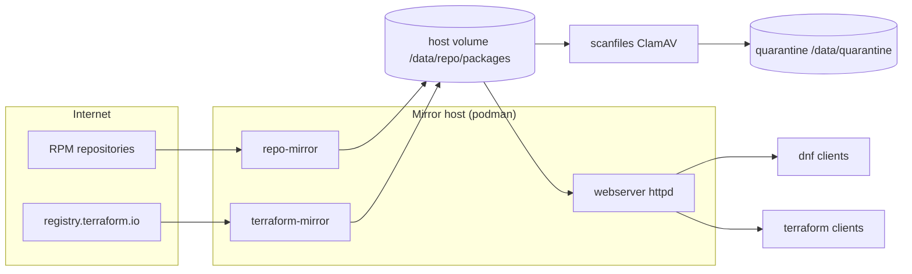

# MirrorRepos — local mirrors for RPM packages and Terraform

Containers that mirror public content onto local disk and serve it to
machines that cannot (or should not) reach the internet:

- **RPM repositories** — synced with `dnf reposync` (Rocky, EPEL, VS Code, ...)
- **Terraform providers & modules** — mirrored from `registry.terraform.io`
- **File scanning** — ClamAV scans files before they are served
- **Web server** — Apache httpd exposes the mirrored content over HTTP(S)

## How it fits together



## Components

| Folder | Purpose | Base image | Writes to (container) |
|---|---|---|---|
| [repo-mirror-base](repo-mirror-base/) | Shared base image: fedora-minimal + dnf + cron | `quay.io/fedora/fedora-minimal:44-x86_64` | — |
| [repo-mirror](repo-mirror/) | RPM repos via `dnf reposync` | `localhost/rpm-repo-mirror-base` | `/data/packages/<repoid>/` |
| [terraform-mirror](terraform-mirror/) | Terraform providers + modules | `localhost/rpm-repo-mirror-base` | `/data/packages/terraform/` |
| [scanfiles](scanfiles/) | ClamAV scan; failures quarantined | `python:3.12-alpine` | — |
| [webserver](webserver/) | httpd serving the mirrored files | `httpd:alpine` | — |
| webserverold/ | legacy, kept for reference | | |

Component docs: [terraform-mirror/readme.md](terraform-mirror/readme.md) ·
[terraform-mirror/standalone.md](terraform-mirror/standalone.md) ·
[scanfiles/readme.md](scanfiles/readme.md) ·
[webserver/readme.md](webserver/readme.md)

## Data and URL layout

One host directory tree is shared by every container; the webserver serves it:

| Content | On the host | In the container | Over HTTP |
|---|---|---|---|
| RPM repositories | `/data/repo/packages/<repoid>/` | `/data/packages/<repoid>/` | `http://<host>:8080/<repoid>/` |
| Terraform mirror | `/data/repo/packages/terraform/` | `/data/packages/terraform/` | `http://<host>:8080/terraform/` |
| Logs | `/data/log/` | `/var/log/` | — |
| RPM repo config | `/data/config/` | `/config/` | — |
| Terraform config | `/data/config-terraform/` | `/config/` | — |
| ClamAV signatures | `/data/clamav-db/` | `/clamav-db/` | — |
| ClamAV quarantine | `/data/quarantine/` | `/quarantine/` | — |

(Host port 8080 → container 80 keeps podman rootless-friendly; adjust to taste.)

## Quickstart

```bash
cd ~/MirrorRepos

# 0. One-off host prep (first time only)
sudo mkdir -p /data/repo /data/log /data/config /data/config-terraform /data/quarantine /data/clamav-db
sudo cp -r repo-mirror/config/. /data/config/
sudo cp -r terraform-mirror/config/. /data/config-terraform/
# rootless podman must OWN these dirs to SELinux-relabel them (:z) —
# without this, containers fail with "lsetxattr ... operation not permitted"
sudo chown -R $USER:$USER /data/repo /data/log /data/config /data/config-terraform /data/quarantine /data/clamav-db

# 1. Build the shared base image
podman build -t rpm-repo-mirror-base ./repo-mirror-base

# 2. Mirror RPM repositories (-d: runs detached via cron; logs: /data/log/mirror-repo.log)
podman build -t rpm-repo-mirror ./repo-mirror
podman run -d --replace -v /data/repo:/data:z -v /data/log:/var/log/:z \
  -v /data/config:/config:z --name rpm-repo-mirror rpm-repo-mirror

# 3. Mirror Terraform providers + modules
podman build -t terraform-mirror ./terraform-mirror
podman run -d --replace -v /data/repo:/data:z -v /data/log:/var/log/:z \
  -v /data/config-terraform:/config:z --name terraform-mirror terraform-mirror

# 4. Serve everything over HTTP (stock httpd image + our config + certs)
#    (the httpscert mount is required — httpd.conf loads SSLCertificateFile
#     from /httpscert and refuses to start without it; --replace reuses the
#     container name if it already exists)
podman run -d --replace --name webserver -p 8080:80 -p 8443:443 \
  -v /data/repo/packages:/data/packages:ro,z \
  -v $PWD/webserver/httpd.conf:/usr/local/apache2/conf/httpd.conf:ro,z \
  -v $PWD/webserver/httpscert:/httpscert:ro,z \
  httpd:alpine

# 4b. Open the firewall so other machines can reach the webserver
sudo firewall-cmd --add-port=8080/tcp --add-port=8443/tcp --permanent
sudo firewall-cmd --reload

# 5. Optional: scan the mirrored files with ClamAV
podman build -t cvdupdate ./scanfiles
bash scanfiles/cv-update.sh    # download/update the signature DB (run daily)
bash scanfiles/scanfiles.sh    # scan /data/repo/packages, quarantine failures
```

Verify — manually:

```bash
curl -s http://localhost:8080/ | head     # index of mirrored content
curl -s http://localhost:8080/terraform/registry.terraform.io/hashicorp/aws/index.json
```

or run the verification script, which checks host tools, data directories,
config files, SELinux, container images, **firewall rules**, the running
webserver and the mirrored content. Failed checks are recapped with a ❌
at the end:

```bash
bash verify-setup.sh          # check everything (read-only)
bash verify-setup.sh --fix    # also repair what it can (opens the firewall ports; uses sudo)
```

> **Optional — rebuild with the latest packages.** The base image bakes in
> `dnf update` at build time, so rebuild periodically to ship current
> packages. Pull the upstream base first (so you get the newest Fedora),
> then rebuild every layer with `--no-cache`:
>
> ```bash
> podman pull quay.io/fedora/fedora-minimal:44-x86_64
> podman build --no-cache -t rpm-repo-mirror-base ./repo-mirror-base
> podman build --no-cache -t rpm-repo-mirror ./repo-mirror
> podman build --no-cache -t terraform-mirror ./terraform-mirror
> ```

Clients then point at the mirror:

- **dnf** — a `.repo` file with `baseurl=http://<host>:8080/<repoid>/`
- **terraform** — `provider_installation { network_mirror { url = "http://<host>:8080/terraform/" } }`
  in `~/.terraformrc`; modules are referenced as archive URLs.
  See [terraform-mirror/readme.md — Client configuration](terraform-mirror/readme.md#client-configuration).

Each component also ships a `run-me.sh`, `docker-compose.yml` and/or a
systemd **quadlet** (`*.container`) for scheduled / run-as-a-service use —
see the per-folder readmes for details.

---

## Prerequisites


### Install Podman

The mirrors are designed to run **rootless** under podman, using a
dedicated service account.

Reference:
[RHEL: allowing rootless containers in Podman](https://docs.redhat.com/en/documentation/red_hat_enterprise_linux/8/html/building_running_and_managing_containers/assembly_starting-with-containers_building-running-and-managing-containers#proc_upgrading-to-rootless-containers_assembly_starting-with-containers)

Ensure Sub UIDs do not clash with other users.
```bash
# check existing users
sudo cat /etc/subuid
```
Allocate Sub UserIds
```bash
sudo useradd repo-mirror-sv
sudo passwd repo-mirror-sv

sudo  usermod --add-subuids 200000-201999 --add-subgids 200000-201999 repo-mirror-sv
sudo  usermod --add-subuids 202000-202999 --add-subgids 202000-202999 <userid>
podman ps
```

Create a new Linux Group to access resources
```bash
sudo groupadd podman-repo-mirror 
sudo usermod --append --groups podman-repo-mirror repo-mirror-sv
sudo usermod --append --groups podman-repo-mirror <userid2>

# verify users have been added
grep 'podman-repo-mirror' /etc/group
```

Grant Group access to directories on the host
```bash
sudo mkdir -p /data/repo /data/log /data/config /data/config-terraform

# /data/config* are mounted at /config in the containers,
# so mirror configs can be updated without rebuilding the images.
sudo cp -r MirrorRepos/repo-mirror/config/. /data/config/
sudo cp -r MirrorRepos/terraform-mirror/config/. /data/config-terraform/

sudo chown -R repo-mirror-sv:podman-repo-mirror /data/repo
sudo chown -R repo-mirror-sv:podman-repo-mirror /data/log
sudo chown -R repo-mirror-sv:podman-repo-mirror /data/config
sudo chown -R repo-mirror-sv:podman-repo-mirror /data/config-terraform

```

|flag|description |Permission|
|-----|---|------------|
|d    |directory| |
|r    |<span style="color:red;">Owner</span>| can read |
|w    |<span style="color:red;">Owner</span>| can write|
|x    |<span style="color:red;">Owner</span> | can execute files and list dir content|
|r    |<span style="color:blue;">Group members</span> |can read|
|-    |<span style="color:blue;">Group members</span> |can NOT write|
|x    |<span style="color:blue;">Group members</span> |can execute files and list dir content|
|r    |<span style="color:green;">Other users</span>|can read|
|-    |<span style="color:green;">Other users</span>|can NOT write|
|x    |<span style="color:green;">Other users</span>|can execute files and list dir content|

drwxr-xr-x. 2 root podman-repo-mirror


```bash
# Verify Ownership has changed
ls -la /data/
ls -la /data/repo/
```

## repo-mirror Image Project Structure

- **Dockerfile**: Contains instructions to build the Docker image for the RPM repository mirror.
- **scripts/mirror-repo.sh**: Script responsible for syncing the RPM repositories using `dnf` or `yum`.
- **config/repo-config.repo**: Configuration file specifying the repository URLs and options for synchronization.
- **data**: Directory to hold mirrored repository data. (Tracked by Git with `.gitkeep`)
- **docker-compose.yml**: Defines services, networks, and volumes for the Docker application.
- **README.md**: Documentation for building and running the Docker container.

## Building base image 
To build the base  image, navigate to the project directory and run:

First build the base Image
```bash
podman build -t rpm-repo-mirror-base ./repo-mirror-base
# or with no-cache
podman build --no-cache -t rpm-repo-mirror-base ./repo-mirror-base

```

Before building `repo-mirror` project, update to ensure  the correct Repos are configure for mirroring: 
  - ./repo-mirror-base/config/all.repos
  - ./repo-mirror-base/config/repos

Add any more repos you need. 
`./repo-mirror-base/config/all.repos`
```ini
[rocky-9.6-x86_64-baseos]
[code]
```
`./repo-mirror-base/config/repos/rocky.repo`
```ini
[rocky-9.6-x86_64-baseos]
name=Rocky Linux $releasever - BaseOS
baseurl=http://dl.rockylinux.org/pub/rocky/9/BaseOS/x86_64/os/
gpgcheck=1
enabled=1
countme=1
metadata_expire=6h
gpgkey=file:///etc/pki/rpm-gpg/RPM-GPG-KEY-Rocky-9
```

`./repo-mirror-base/config/repos/vscode.repo`
```ini
[code]
name=Visual Studio Code
baseurl=https://packages.microsoft.com/yumrepos/vscode/
enabled=1
gpgcheck=1
gpgkey=https://packages.microsoft.com/keys/microsoft.asc
```

### Build the image
```bash
podman build -t rpm-repo-mirror ./repo-mirror
# or
podman build --no-cache -t rpm-repo-mirror ./repo-mirror

```
### Export image so Service Account can use it

```bash
podman save -o /tmp/rpm-repo-mirror.tar --format oci-archive rpm-repo-mirror
ssh repo-mirror-sv@localhost
podman load -i /tmp/rpm-repo-mirror.tar 
```


### Running the Container

The images should now have the latest updates and it's ready to run.  
Run the container with these volumes:
  - /data     -> directory to persist the mirrored repository data.
  - /var/log/:z -> Logs
  - /config  ->  /config

```bash
# sudo su repo-mirror-sv

podman run --rm -v /data/repo:/data:z -v /data/log:/var/log/:z -v /data/config:/config:z  -it --name rpm-repo-mirror rpm-repo-mirror
```

### Watch running logs
```bash
tail -f /data/log/mirror-repo-entry.log 
tail -f /data/log/dnf5.log 
```

### Results

After running the container, the RPM repositories listed in `config/all.repos`
are synchronized under `/data/repo/packages/<repoid>/` on the host.

## Build the Web Server

Non-root containers cannot bind privileged ports (80/443). Options:

- map a high host port, e.g. `-p 8080:80` (used in the Quickstart above)
- run httpd directly on the host — see [webserver/readme.md](webserver/readme.md)
- place a proxy such as Nginx in front on 443    

To srsolve the issue, update the iptable to route 443 to 8443

Set a rule that redirects all incoming HTTP (TCP port 80) traffic to TCP port 8080 on the same machine, before routing decisions are made.

This is commonly used when:

    Running a service (e.g., a web server or proxy) on a non-privileged port like 8080.

    You want it to be accessible via the standard port 80 without giving the service root privileges.

```bash
# Add rules:
sudo iptables -t nat -A PREROUTING -p tcp --dport 80 -j REDIRECT --to-port 8080
sudo iptables -t nat -A PREROUTING -p tcp --dport 443 -j REDIRECT --to-port 8443

# The PREROUTING chain only affects packets coming from outside the host (i.e., not from localhost).
# If you are testing with curl http://localhost or a browser on the same machine, use the OUTPUT chain instead:
sudo iptables -t nat -A OUTPUT -p tcp --dport 80 -j REDIRECT --to-port 8080


# show it worked
sudo iptables -t nat -L -n -v
# or just the Prerouting rules 
sudo iptables -t nat -L PREROUTING -n -v

# DELETE rules:
sudo iptables -t nat -D PREROUTING -p tcp --dport 80 -j REDIRECT --to-port 8080
sudo iptables -t nat -D PREROUTING -p tcp --dport 443 -j REDIRECT --to-port 8443

```

In this example it will be run it as root. 
```bash
podman build -t file-browser ./webserver

# Save Image so it can be loaded
podman save -o /tmp/file-browser.tar --format oci-archive file-browser
```


# Run on Boot

## User setup for start on Boot

Use a service account `repo-code-sv`
```bash
sudo useradd repo-browser-sv
sudo passwd repo-browser-sv

```
## add user to group

Create a group, and add the user 
```bash
sudo groupadd podman-repo-mirror
sudo usermod --append --groups podman-repo-mirror repo-browser-sv

# verify user works
su -l repo-browser-sv
podman ps
```

Allow `service user` account to start a service at system start that persists over logouts.

```bash
ssh repo-browser-sv@localhost

loginctl show-user repo-browser-sv | grep ^Linger
Linger=no

loginctl enable-linger repo-browser-sv

loginctl show-user repo-browser-sv | grep ^Linger
Linger=yes

exit
```

## run the HTTP Server

Confirm the web Server works
```bash

podman load -i /tmp/file-browser.tar

podman run -d --name my-httpd -p 8080:80   -v /data/repo-mirror/:/data/:Z  file-browser
``` 

## Export Image from Podman
Export the build image so it can be load into the profile for the service account or moved to another server

```bash
podman images  -a fedora/fedora-minimal --no-trunc
podman export -o quay.io_fedora_fedora-minimal_43-x86_64.tar sha256:cc3a8d84b8c80a5cea864e90ec58dec86d50ce78aec13bd1a0be45aa95cf3e59

podman save -o rpm-repo-mirror.tar --format oci-archive rpm-repo-mirror
mv rpm-repo-mirror.tar /tmp/
```

## As the (`repo-code-sv`) service Account, load the OCI Image into the registry 
```bash
ssh repo-code-sv@localhost
podman load -i /tmp/rpm-repo-mirror.tar 

sudo mkdir /data
sudo mkdir /data/repos

# chown USER:GROUP FILE
sudo chown repo-code-sv:podman-repo-mirror /data
sudo chown repo-code-sv:podman-repo-mirror /data/repos

```
 ### Another Example of exporting images
```bash
podman pull ghcr.io/steele-ntwrk/custom-netbox-dtli:offline
podman images  -a ghcr.io/steele-ntwrk/custom-netbox-dtli --no-trunc
podman save -o custom-netbox-dtli.tar --format oci-archive sha256:7e3329d675895dc1834cda96f8b8ddfd2eea5ff7614a61fbd705617ce05137f3

# Get it off the vm and on to a desktop
scp paul@192.168.122.243:/home/paul/custom-netbox-dtli.tar   /tmp/

# On target machine 
podman load -i  custom-netbox-dtli.tar  


```

## Run the Container so and create SYSTEMD
```bash
podman run -v /data/repos:/data:Z -it --name rpm-repo-mirror rpm-repo-mirror

podman generate systemd --new --files --name rpm-repo-mirror
```
## rootless containers running under Systemd
```bash
podman generate systemd --name --new rpm-repo-mirror

mkdir -p $HOME/.config/containers/systemd 
vi $HOME/.config/containers/systemd/container-rpm-repo-mirror.service

mkdir -p ~/.config/systemd/user/
mv $HOME/.config/containers/systemd/container-rpm-repo-mirror.service ~/.config/systemd/user/
# $HOME/.config/containers/systemd/container-rpm-repo-mirror.service

systemctl --user daemon-reload

systemctl --user start container-rpm-repo-mirror
systemctl --user is-active container-rpm-repo-mirror
systemctl --user status container-rpm-repo-mirror

podman ps
```

## Create a timer for starting the Service.
```bash
vi ~/.config/systemd/user/container-rpm-repo-mirror-timer.timer
```

```ini
[Unit]
Description=container-rpm-repo-mirror Timer
Requires=container-rpm-repo-mirror.service

[Timer]
OnCalendar=*:00/5:00
Unit=container-rpm-repo-mirror.service

[Install]
WantedBy=timers.target
```

```bash
systemctl --user daemon-reload

systemctl --user start container-rpm-repo-mirror-timer.timer
systemctl --user is-active container-rpm-repo-mirror-timer.timer
systemctl --user status container-rpm-repo-mirror-timer.timer
```

dnf reposync \
    -p /data/packages/ \
    --repoid="$repo_id" \
    --newest-only \
    --download-metadata \
    --setopt="$repo_id.basearch=x86_64" \
    --setopt="$repo_id.releasever=8" 
    --setopt="$repo_id.infra=stock" \
    --setopt="$repo_id.contentdir=pub/epel"

dnf reposync \
  --repoid=epel-cisco-openh264 \
  --releasever=8 \
  --download-metadata \
  --download-path=/data/packages/


dnf reposync   --repoid=epel-cisco-openh264  --newest-only --releasever=8  --basearch=x86_64  --download-metadata   --download-path=/data/packages/


dnf reposync \
  --repoid=epel-cisco-openh264 \
  --releasever=9 \
  --newest-only \
  --setopt=basearch=x86_64 \
  --download-metadata \
  --download-path=/data/packages/


dnf reposync \
  --repoid=epel-cisco-openh264 \
  --releasever=9 \
  --forcearch=x86_64 \
  --download-metadata \
  --newest-only \
  --delete \
  --download-path=/data/packages/
